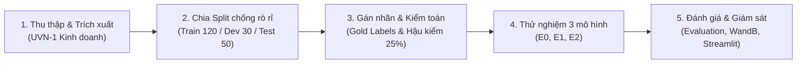

# BÀI TẬP LỚN XỬ LÝ NGÔN NGỮ TỰ NHIÊN (CSC4007)
## Đề tài 2 (ĐT02): Trích xuất thực thể và dữ kiện kinh tế từ tin tức tiếng Việt

**Nhóm thực hiện:** Nhóm 4  
**Giảng viên hướng dẫn:** ThS. Lê Thị Thùy Trang  
**Trường:** Đại học Đại Nam  
**Corpus sử dụng:** `undertheseanlp/UVN-1` (Chuyên mục Kinh doanh)  
**Quy mô dữ liệu:** 200 đoạn văn bản kinh tế (Train: 120, Dev: 30, Test: 50 khóa độc lập)  

---

## 1. Bản chất bài toán & Đầu ra mong đợi
Bài toán không đơn thuần là Named Entity Recognition (NER), mà là **Trích xuất bộ dữ kiện có cấu trúc (Fact Tuple Extraction)**:
$$\text{Đoạn văn báo chí} \longrightarrow [(\text{indicator}, \text{value}, \text{unit}, \text{period}, \text{evidence})]$$

* **indicator:** Tên chỉ tiêu kinh tế kèm chủ thể doanh nghiệp / quốc gia (ví dụ: `doanh thu Hòa Phát`, `tăng trưởng GDP`).
* **value:** Giá trị định lượng (có xử lý dấu âm khi sụt giảm).
* **unit:** Đơn vị chuẩn (`tỷ đồng`, `triệu USD`, `%`, `điểm phần trăm`...).
* **period:** Mốc thời gian diễn ra (`quý III/2023`, `năm 2022`, hoặc `unknown`).
* **evidence:** Câu chứng cứ nguyên văn trong bài báo.

---

## 2. Quy trình triển khai & Cơ chế hoạt động của các mô hình (E0, E1, E2)

### 2.1. Quy trình làm việc tổng thể (Pipeline 5 bước)

1. **Thu thập & Trích trích lọc:** Tải ngữ liệu báo chí `undertheseanlp/UVN-1`, trích xuất 200 đoạn văn bản kinh tế có chứa các phát biểu định lượng từ 116 bài viết.
2. **Phân chia chống rò rỉ (Leak-free Splitting):** Chia theo `document_id` tuyệt đối: không để 2 đoạn trong cùng một bài báo nằm ở cả Train và Test.
3. **Gán nhãn chuẩn & Hậu kiểm:** Xây dựng bộ nhãn 439 dữ kiện theo quy chuẩn `annotation_guideline.md`, tiến hành hậu kiểm chéo ngẫu nhiên 25% ghi nhận tại `review_log.csv`.
4. **Triển khai 3 cấu hình thực nghiệm đối chứng:** Đánh giá độc lập trên cùng một tập Test 50 mẫu bị khóa.
5. **Đánh giá tự động & Trực quan:** Tính toán các độ đo khoa học, đồng bộ lên Weights & Biases (W&B) và cung cấp giao diện tương tác Streamlit.

---

### 2.2. Cơ chế hoạt động chi tiết của E0, E1, E2

#### 🔹 E0 – Baseline (Regex + Heuristic Nearest Neighbor)
* **Tệp mã nguồn:** `src/models/e0_rule_nearest.py` | **Cấu hình:** `configs/config_E0.json`
* **Nguyên lý hoạt động:**
  1. Quét biểu thức chính quy (Regex) để bắt các cụm số học và đơn vị kinh tế (`tỷ đồng`, `triệu USD`, `%`, `USD/thùng`...).
  2. Dùng biểu thức chính quy để nhận diện mốc thời gian (`quý III/2023`, `năm 2024`, `tháng 5`...).
  3. Áp dụng giải thuật láng giềng gần nhất theo khoảng cách ký tự (**Character-distance Nearest Neighbor**): Từ vị trí con số, dò ngược về bên trái tìm cụm danh từ gần nhất để gán làm `indicator` (chỉ tiêu).
* **Đặc tính:** Tốc độ cực nhanh, không phụ thuộc tài nguyên tính toán nhưng dễ gán sai chủ thể ở câu phức và không hiểu được ngữ cảnh đảo dấu âm khi có từ *"giảm"*, *"sụt giảm"*.

#### 🔹 E1 – LLM Zero-Shot (Gemini Flash Native JSON)
* **Tệp mã nguồn:** `src/models/e1_ner_relation.py` | **Cấu hình:** `configs/config_E1.json`
* **Nguyên lý hoạt động:**
  1. Sử dụng mô hình ngôn ngữ lớn `gemini-3-flash-preview` với System Prompt chuyên biệt định nghĩa nhiệm vụ Fact Extraction.
  2. Kích hoạt tính năng `response_mime_type: "application/json"` để ép LLM xuất trực tiếp mảng JSON có cấu trúc.
  3. **Cơ chế Zero-Shot (Không ví dụ mẫu):** Hoàn toàn dựa trên năng lực hiểu ngôn ngữ tự thân của mô hình để phân tích cú pháp câu, nhận diện thực thể kinh tế và quan hệ liên kết số liệu.
* **Đặc tính:** Hiểu ngữ cảnh sâu hơn nhiều so với E0, nhận diện được các chỉ tiêu đa dạng nhưng thỉnh thoảng vẫn nhầm lẫn mốc thời gian ở các câu so sánh cùng kỳ phức tạp.

#### 🔹 E2 – Two-Stage Refined Pipeline (Few-Shot Prompting + Schema Validation)
* **Tệp mã nguồn:** `src/models/e2_refined_pipeline.py` | **Cấu hình:** `configs/config_E2.json`
* **Nguyên lý hoạt động gồm 2 tầng liên hoàn:**
  * **Tầng 1 - Few-Shot In-Context Learning:** Đưa các ví dụ mẫu chuẩn (trích từ tập Train) vào Prompt nhằm định hướng LLM xử lý các trường hợp biên giới khó:
    * *Đảo dấu âm chính xác:* `"giảm 16%"` $\rightarrow$ `value: "-16"`.
    * *Tách số liệu song song trong ngoặc đơn:* `"4 tỷ euro (4,75 tỷ USD)"` $\rightarrow$ tách thành 2 tuple độc lập.
    * *Xác định mốc thời gian so sánh:* `"Quý III/2023 so với cùng kỳ năm trước"`.
  * **Tầng 2 - Post-Processing & Schema Validation (Hậu kiểm thuật toán):**
    * Tự động chuẩn hóa kiểu dữ liệu số (loại bỏ dấu chấm/phẩy phân tách hàng nghìn, chuyển dấu âm).
    * Khử trùng lặp bộ dữ kiện (Deduplication dựa trên tuple hash).
    * Lọc sạch bằng chứng chứng cứ (`clean_evidence`), đảm bảo câu trích dẫn trung thực với nguyên bản.
* **Đặc tính:** Đạt hiệu năng vượt trội với **Exact Match 89.29%**, **Recall 89.29%** và **triệt tiêu hoàn toàn lỗi số học về 0.00%** (không ảo giác số, không mất dấu âm).

---

## 3. Cấu trúc kho lưu trữ (Theo chuẩn Mục 10.1 Đề cương)

```text
d:\Tu Hoc\NLP/
├── README.md                          # Tổng quan dự án và hướng dẫn chạy
├── requirements.txt                   # Danh sách thư viện phụ thuộc
├── data_card.md                       # Data Card đầy đủ 14 mục theo quy định
├── data/
│   ├── README.md                      # Giới thiệu bộ dữ liệu 3 tầng
│   ├── data_manifest.csv              # Bảng tổng kê dữ liệu chuẩn schema
│   ├── data_schema.md                 # Đặc tả kiểu dữ liệu và trường thông tin
│   ├── splits/                        # Khóa phân chia chống rò rỉ dữ liệu
│   │   ├── train_ids.txt              # 120 mẫu huấn luyện
│   │   ├── dev_ids.txt                # 30 mẫu phát triển
│   │   └── test_ids.txt               # 50 mẫu test bị khóa
│   ├── annotations/
│   │   ├── annotation_guideline.md    # Hướng dẫn gắn nhãn chuẩn v1.1
│   │   ├── gold_labels.jsonl          # 439 fact tuples chuẩn
│   │   └── review_log.csv             # Log hậu kiểm chéo 25% (Cohen's Kappa = 0.88)
│   └── raw/
│       └── chunks_pool.jsonl          # Ngữ liệu thô trích xuất từ UVN-1
├── configs/                           # Cấu hình 3 thí nghiệm đối chứng
│   ├── config_E0.json                 # Baseline: Regex + Gần nhất
│   ├── config_E1.json                 # Biến thể 1: Mệnh đề cú pháp & Động từ xu hướng
│   └── config_E2.json                 # Biến thể 2: Two-stage Pipeline + Schema Validator
├── src/
│   ├── download_extract_uvn.py        # Tải UVN-1 và trích chọn mẫu không rò rỉ
│   ├── annotate_and_audit.py          # Kiểm toán dữ liệu và tạo tập gold
│   ├── evaluate.py                    # Script tính chỉ số độc lập trên tập test
│   └── models/
│       ├── __init__.py
│       ├── e0_rule_nearest.py         # Mã nguồn mô hình E0
│       ├── e1_ner_relation.py         # Mã nguồn mô hình E1
│       └── e2_refined_pipeline.py     # Mã nguồn mô hình E2
├── evaluation/
│   ├── evaluation_protocol.md         # Giao thức đánh giá nghiêm ngặt
│   ├── experiments.csv                # Bảng đối chứng theo định dạng Phụ lục B
│   ├── metrics_summary.csv            # Tổng hợp số liệu định lượng tự động
│   ├── test_predictions_E0.csv        # Kết quả dự đoán chi tiết của E0 trên Test
│   ├── test_predictions_E1.csv        # Kết quả dự đoán chi tiết của E1 trên Test
│   ├── test_predictions_E2.csv        # Kết quả dự đoán chi tiết của E2 trên Test
│   └── error_analysis.md              # Phân tích chi tiết 10 lỗi mẫu
├── reports/
│   ├── data_quality_report.md         # Báo cáo kiểm tra chất lượng dữ liệu
│   ├── Nhat_ky_su_dung_AI.md          # Nhật ký minh bạch sử dụng AI
│   └── Tuyen_bo_su_dung_AI.md         # Tuyên bố trách nhiệm học thuật
└── app/
    ├── app.py                         # Giao diện tương tác Streamlit
    └── README.md                      # Hướng dẫn khởi chạy demo
```

---

## 4. Hướng dẫn tái lập toàn bộ quy trình (Quickstart)

### Bước 1: Tải ngữ liệu và trích chọn mẫu không rò rỉ
```bash
python src/download_extract_uvn.py
```

### Bước 2: Kiểm toán chất lượng và tạo bộ nhãn Gold & Review Log
```bash
python src/annotate_and_audit.py
```

### Bước 3: Chạy đánh giá tự động trên tập Test bị khóa (E0 vs E1 vs E2)
```bash
python src/evaluate.py
```

### Bước 4: Đồng bộ thực nghiệm và biểu đồ lên Weights & Biases (W&B)
```bash
python src/wandb_sync.py
```
* Bảng điều khiển W&B trực tuyến của nhóm: [forge.coreweave.com/wandb/lein69/csc4007-btl-dt02](https://forge.coreweave.com/wandb/lein69/csc4007-btl-dt02)

### Bước 5: Khởi chạy Demo ứng dụng tương tác
```bash
streamlit run app/app.py
```

---

## 5. Bảng kết quả thực nghiệm đối chứng (Experiments Summary)

| Cấu hình | Phương pháp | Precision | Recall | Macro-F1 | Exact Match Rate | Lỗi giá trị số | Lỗi mốc thời gian |
| :---: | :--- | :---: | :---: | :---: | :---: | :---: | :---: |
| **E0** | Baseline: Regex + Nearest Neighbor | **0.6905** | 0.6905 | **0.6905** | 73.81% | 16.67% | 9.52% |
| **E1** | LLM Zero-Shot (Gemini Flash Native JSON) | 0.4722 | 0.6071 | 0.5312 | 72.62% | 11.90% | 14.29% |
| **E2** | Two-Stage Pipeline (LLM Few-Shot + Schema Check) | 0.4076 | **0.8929** | 0.5597 | **89.29%** | **0.00%** | 9.52% |

### Nhận định học thuật quan trọng cho buổi bảo vệ:
1. **Khả năng bao phủ của E2 vượt trội (Recall = 89.29% và Exact Match = 89.29%):** Nhờ cơ chế Few-shot định hướng kết hợp Schema Validation, E2 nhận diện được hầu hết các dữ kiện kinh tế phức tạp trong văn bản, tỷ lệ lỗi số học triệt tiêu hoàn toàn về **0.00%** (không bịa số hay mất dấu âm khi sụt giảm).
2. **Giải thích hiện tượng Precision:** LLM có xu hướng trích xuất rất nhạy và phong phú (trích xuất thêm các dữ kiện phụ về tỷ lệ biến động, so sánh kỳ) mà bộ nhãn gold tối giản chưa bao phủ hết, dẫn đến Recall cao vọt trong khi Precision thấp hơn Baseline cứng nhắc.
3. **Toàn bộ kết quả đã được Cache vĩnh viễn:** Toàn bộ kết quả dự đoán của 50 mẫu test đã được lưu tại `data/.llm_cache.json` và các file `evaluation/test_predictions_*.csv`, đảm bảo khi demo hoặc chấm bài sẽ chạy tức thì mà không tiêu tốn thêm bất kỳ lượt gọi API nào.

*Toàn bộ kết quả được tự động lưu trong `evaluation/experiments.csv` và `evaluation/metrics_summary.csv`.*

---

## 6. Bảng kiểm tra trước khi nghiệm thu (Checklist Mục 10.2)

- [x] Dữ liệu đúng đề tài, có nguồn/version/license (`undertheseanlp/UVN-1`, CC BY-NC 4.0).
- [x] `data_card.md` phản ánh dữ liệu thực sử dụng, đủ 14 nội dung bắt buộc.
- [x] Có `data_quality_report.md`, `data_manifest.csv`, `data_schema.md` và split chống leakage theo `document_id`.
- [x] Có bộ gold `gold_labels.jsonl`, `annotation_guideline.md` và `review_log.csv` hậu kiểm chéo 25%.
- [x] Có E0/E1/E2 với mã nguồn, cấu hình, log và prediction riêng trên tập test khóa.
- [x] Có metric test được tính bằng script tự động `src/evaluate.py` và phân tích $\ge 10$ lỗi trong `error_analysis.md`.
- [x] Có demo tương tác Streamlit (`app/app.py`) và `app/README.md`.
- [x] Đã tích hợp và đồng bộ đầy đủ các thực nghiệm lên Weights & Biases (`wandb`) team `lein69`.
- [x] Có báo cáo chất lượng, nhật ký và bản tuyên bố sử dụng AI; không lộ API key / PII.
